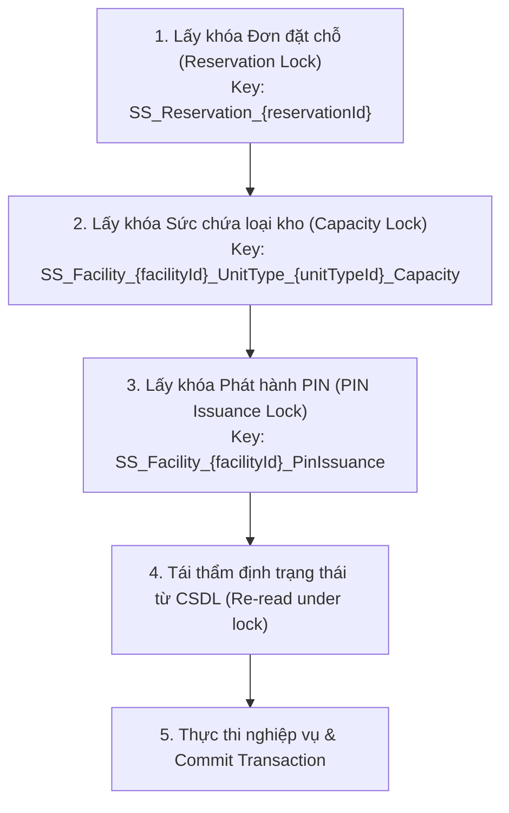

# Báo Cáo Hoàn Thiện & Nghiệm Thu Backend Chức Năng 5: Check-in & Digital Handover

- **Dự án**: Self-Storage Facility Rental and Management System
- **Học phần**: PRN222
- **Thời gian hoàn thành**: 09/10/2026
- **Branch**: `Check-in-and-Digital-Handover`
- **Baseline commit**: `ba599208badb2f0e011ae65355d088d0374f1acd` (trên nhánh `Payment&RentalAgreement`)
- **Kiến trúc áp dụng**: Strict 3-Layer Architecture (.NET 8, ASP.NET Core Web API, EF Core 8 Database-First, SQL Server `core` schema)
- **Tình trạng kiểm thử**:
  - **Unit Tests (`CheckInServiceTests`)**: 26 Passed / 26 Total (100%)
  - **Web API Integration Tests (`CheckInIntegrationTests`)**: 3 Passed / 3 Total (100%)
  - **Real SQL Server Concurrency & Rollback Tests (`CheckInSqlServerConcurrencyTests`)**: 4 Passed / 4 Total (100%)
  - **Toàn bộ Solution Non-Concurrency Tests**: 208 Passed, 0 Failed, 0 Skipped

---

## 1. Tổng Quan Triển Khai Nghiệp Vụ

Chức năng 5 (Check-in & Digital Handover) giải quyết khâu tiếp nhận khách hàng tại quầy cơ sở, xác minh danh tính, phân bổ ô lưu trữ vật lý, nghiệm thu ô lưu trữ, kích hoạt hợp đồng và cấp phát chứng thư số (mã PIN bàn giao điện tử).

### A. Điều kiện tiên quyết để kích hoạt Check-in:
1. **Trạng thái đặt chỗ & hợp đồng**: Đơn giữ chỗ ở trạng thái `confirmed`, hợp đồng thuê ở trạng thái `scheduled`.
2. **Kỳ hạn thuê hợp lệ**: Ngày hiện tại tại múi giờ cơ sở (`FacilityTimeHelper`) thỏa mãn `start_date <= today < end_date`. (Chưa hỗ trợ nhận kho sớm trước 24 giờ).
3. **Thanh toán đầy đủ**: Hóa đơn chu kỳ đầu tiên liên kết đúng reservation/agreement phải ở trạng thái `paid`, `paid_amount == total_amount` và `total_amount > 0`.
4. **Phân quyền nhân viên quầy nghiêm ngặt**:
   - Thao tác viên phải có tài khoản `active`, mang role `facility_staff` hoặc `facility_manager`.
   - Có `employee_profile` đang hoạt động (`employment_status = 'active'`).
   - Có phân công công tác còn hiệu lực tại đúng cơ sở của đơn đặt chỗ (`starts_at <= now <= ends_at`).
   - Danh tính lấy 100% từ ClaimsPrincipal (`User.FindFirstValue(ClaimTypes.NameIdentifier)`); không nhận staff ID, role hay facilityId từ request body/query.
   - **Không áp dụng bypass** của Quản trị viên (Admin) hoặc Quản lý vận hành (Operations Manager) cho các thao tác tác nghiệp quầy check-in.

---

## 2. Danh Sách Endpoint & Thiết Kế API

Tất cả các endpoint trả về định dạng chuẩn `ApiResponse<T>`, kèm HTTP Status Codes tường minh (`200 OK`, `400 Bad Request`, `401 Unauthorized`, `403 Forbidden`, `404 Not Found`, `409 Conflict`, `500 Internal Server Error`). Controller không truy vấn DbContext hoặc Repository trực tiếp.

### 2.1. Nhóm API Quầy (Staff Check-in Operations) — `CheckInController`
Được bảo vệ bằng `[Authorize(Roles = "facility_staff,facility_manager")]` và kiểm tra quyền cơ sở qua `IFacilityScopeService.HasCheckInCounterAccessAsync`:

| STT | Method | Endpoint | Request Body / Query | Response DTO | Mô tả nghiệp vụ |
|:---:|:---:|---|---|---|---|
| **1** | `GET` | `/api/staff/check-in/search?code={code}` | Query: `code` | `CheckInSearchResponse` | Tra cứu hồ sơ check-in theo mã reservation hoặc số agreement. Trả về thông tin khách (che số giấy tờ), kỳ hạn, hóa đơn, tiến độ xác minh, gán ô, nghiệm thu và lý do nếu chưa đủ điều kiện check-in. |
| **2** | `GET` | `/api/staff/check-in/{reservationId}/eligible-units` | Route: `reservationId` | `List<EligibleUnitResponse>` | Liệt kê các ô kho khả dụng: cùng `facility_id`, cùng `unit_type_id`, `is_listed=true`, `physical_status='available'`, không có lệnh bảo trì chặn booking, không trùng allocation active trong kỳ hạn thuê. |
| **3** | `POST` | `/api/staff/check-in/{reservationId}/verify-id` | `VerifyIdentityRequest` (`verificationMethod`, `documentNumber`, `isConfirmedMatch`, `notes`) | `IdentityVerificationResponse` | Xác minh giấy tờ tùy thân (`government_id`, `passport`). Đối chiếu khớp số nếu hồ sơ đã có; cập nhật số vào hồ sơ nếu hồ sơ chưa có và xác minh đạt. Bắt buộc nhân viên xác nhận đối chiếu mặt. |
| **4** | `POST` | `/api/staff/check-in/{reservationId}/assign-unit` | `AssignUnitRequest` (`storageUnitId`) | `UnitAllocationResponse` | Gán ô lưu trữ dưới khóa phân tán: chuyển ô `available` → `reserved`, tạo `unit_allocation` loại `rental`, trạng thái `active`. Idempotent nếu chọn lại cùng ô; trả 409 nếu chọn ô khác khi chưa release ô cũ. |
| **5** | `POST` | `/api/staff/check-in/{reservationId}/release-unit` | `ReleaseUnitRequest` (`currentAllocationId`, `reason`) | `UnitAllocationResponse` | Hủy gán ô trước khi bàn giao: kết thúc allocation cũ, trả ô `reserved` → `available`. Cho phép giải phóng ngay cả khi kỳ hạn thuê đã hết. |
| **6** | `POST` | `/api/staff/check-in/{reservationId}/inspection` | `UnitInspectionRequest` (`currentAllocationId`, `items`, `overallSummary`, `isUnsafe`) | `InspectionResponse` | Nghiệm thu bàn giao với 4 hạng mục bắt buộc: `cửa`, `khóa`, `đèn`, `vệ sinh`. Nếu có mục hư hại hoặc `isUnsafe=true`, tự động ghi nhận thất bại, giải phóng allocation và đưa ô sang `maintenance`. Item condition chỉ nhận `good`, `acceptable`, `damaged`, `missing` (từ chối `not_applicable` cho mục bắt buộc và cấm item condition `unsafe`). |
| **7** | `POST` | `/api/staff/check-in/{reservationId}/complete` | `CompleteCheckInRequest` (`currentAllocationId`, `currentInspectionId`, `customerAcknowledged`, `notes`) | `HandoverCompleteResponse` | Hoàn tất bàn giao trong một transaction: ghi `handover_records`, chuyển agreement `scheduled` → `active`, reservation `confirmed` → `checked_in`, ô `reserved` → `occupied`, sinh PIN 6 số và gửi thông báo `in_app`. Trả PIN 1 lần duy nhất kèm `Cache-Control: no-store`. |
| **8** | `POST` | `/api/staff/check-in/{reservationId}/reissue-pin` | `ReissuePinRequest` (`currentCredentialId`, `documentNumber`, `isConfirmedMatch`, `reason`) | `PinReissueResponse` | Thu hồi credential cũ (`revoked`), cấp mới PIN và credential `active`, lưu audit log an toàn (không sinh notification in_app theo scope). Trả PIN kèm header `Cache-Control: no-store`. |

### 2.2. Nhóm API Khách Hàng (Customer Operations) — `MeController`
Được bảo vệ bằng `[Authorize(Roles = "customer")]`, hoàn toàn cô lập dữ liệu theo danh tính khách hàng đăng nhập:

| STT | Method | Endpoint | Query Parameters | Response DTO | Mô tả nghiệp vụ |
|:---:|:---:|---|---|---|---|
| **9** | `GET` | `/api/me/units` | `pageNumber`, `pageSize` | `PagedResult<CustomerUnitListItemResponse>` | Danh sách các ô lưu trữ khách hàng đang thuê/sở hữu kèm trạng thái hợp đồng, ngày bắt đầu/kết thúc, kỳ hạn credential và thông tin cơ sở. |
| **10** | `GET` | `/api/me/units/{agreementId}/handover` | Route: `agreementId` | `CustomerHandoverResponse` | Xem chi tiết biên bản bàn giao điện tử của hợp đồng (ngày bàn giao, tình trạng kiểm tra, thông tin ô kho, credential ID; tuyệt đối không để lộ mã PIN hay secret digest). |
| **11** | `GET` | `/api/me/notifications` | `pageNumber`, `pageSize` | `PagedResult<CustomerNotificationResponse>` | Danh sách các thông báo nội bộ qua kênh `in_app` của khách hàng theo phân trang. |

---

## 3. Thiết Kế Khóa Phân Tán, Transaction & Chống Race Condition

### 3.1. Phân Cấp Khóa Xác Định (Deterministic Locking Hierarchy)
Để ngăn ngừa triệt để hiện tượng Deadlock khi nhiều nhân viên hoặc khách hàng cùng thao tác đồng thời trên cùng tài nguyên, hệ thống áp dụng cơ chế khóa qua `sys.sp_getapplock` (`LockOwner = 'Transaction'`, mức cô lập `ReadCommitted`) với thứ tự khóa cố định:



- **Môi trường Test In-Memory**: Hệ thống tự động chuyển đổi sang semaphore phân tán theo tên (`ConcurrentDictionary<string, SemaphoreSlim>`), đảm bảo 100% test chạy được trên bộ nhớ mà không cần phụ thuộc vào SQL Server instance.

### 3.2. Tái Thẩm Định Trạng Thái Dưới Khóa (Re-read Under Lock)
Không phụ thuộc vào kết quả kiểm tra sơ bộ ngoài khóa. Khi đã nắm giữ transaction và applock, repository thực hiện:
- Đọc lại thông tin `reservation`, `rental_agreement`, `storage_units`, `invoices`, `identity_verifications`, `inspections`.
- Đảm bảo ô kho vẫn ở trạng thái `available` (đối với Assign) hoặc `reserved` (đối với Complete).
- Đảm bảo allocation và inspection ID gửi từ client khớp chính xác với bản ghi đang hoạt động (phát hiện và từ chối ngay dữ liệu client cũ `STALE_DATA`).

### 3.3. Xử Lý Idempotency An Toàn
- **Gán ô (Assign)**: Nếu gọi lại với đúng ô kho đã gán trong allocation active hiện tại, hệ thống trả về kết quả thành công ngay mà không tạo mới allocation hoặc đổi trạng thái ô.
- **Hoàn tất bàn giao (Complete)**: Nếu gọi lại với đúng allocation ID và inspection ID đã hoàn tất, hệ thống trả về biên bản bàn giao cũ với cờ `IsAlreadyCompleted = true` và `Pin = null`. Không sinh thêm handover, không cấp thêm credential, không gửi thêm notification trùng lặp.

---

## 4. An Toàn Dữ Liệu, HMAC-SHA256, Che Giấy Tờ & Bảo Vệ PIN

1. **Sinh PIN ngẫu nhiên an toàn**:  
   Sử dụng bộ sinh số ngẫu nhiên mật mã học `RandomNumberGenerator.GetInt32(0, 1000000).ToString("D6")`. Đảm bảo chuỗi 6 chữ số luôn bảo toàn số 0 ở đầu.
2. **Băm một chiều Secret Digest**:  
   PIN được mã hóa bằng thuật toán **HMAC-SHA256** với khóa bí mật cấu hình từ `CheckIn:PinHmacSecret` (hoặc biến môi trường `CheckIn__PinHmacSecret` / `CHECKIN_PIN_HMAC_SECRET`). Service fail-fast nếu khóa bí mật không được cấu hình.
3. **Chính sách không lưu trữ Plaintext PIN**:  
   - Tuyệt đối không lưu plaintext PIN trong database (chỉ lưu `secret_digest` trong bảng `core.access_credentials`).
   - Không đưa PIN vào log hệ thống, audit payload hay exception messages.
   - Plaintext PIN chỉ được trả về **duy nhất 1 lần** trong response của `complete` và `reissue-pin`.
   - Mọi response chứa mã PIN đều kèm các HTTP header bảo mật:
     ```http
     Cache-Control: no-store
     Pragma: no-cache
     ```
4. **Mặt nạ giấy tờ tùy thân**:  
   Số giấy tờ khách hàng được hiển thị theo định dạng `079*****1234` (giữ 3 ký tự đầu và 3 ký tự cuối). Tuyệt đối không đưa số giấy tờ vào `notes` hay các trường văn bản tự do.

---

## 5. Tương Tác Trigger & Sửa Lỗi Sức Chứa (Capacity)

### 5.1. Tương Tác Với Trigger SQL Server Sạch:
- **`trg_storage_units_status_history`**: Tự động lưu vết khi trạng thái ô kho thay đổi (`available` → `reserved` → `occupied` / `maintenance`). Code không chèn bản ghi thủ công vào bảng này để tránh trùng lặp.
- **`trg_unit_allocations_validate_bookable`**: Chặn tạo allocation mới trên các ô kho đã `occupied`. Do đó, allocation loại `rental` được tạo từ bước `assign-unit` (khi ô đang `available`), và tiếp tục duy trì trạng thái `active` sau khi complete để bảo vệ trọn vẹn chu kỳ thuê mà không vi phạm trigger.
- **`trg_handover_records_validate_business_rules`**: Đảm bảo tính toàn vẹn 4 bên: `agreement_id`, `unit_allocation_id`, `inspection_id`, và `storage_unit_id` phải khớp nhau.

### 5.2. Khắc Phục Lỗi Tính Đúp Sức Chứa (Capacity Calculation Fix):
- Trước đây, `FacilityCatalogRepository` và `ReservationRepository` đếm tất cả các reservation `confirmed` mà chưa xét đến việc reservation đó đã có agreement được gán ô vật lý (`unit_allocations.status = 'active'`).
- Đã chỉnh sửa logic truy vấn tại:
  - [`FacilityCatalogRepository.cs`](file:///d:/FPT/PRN222/Project/Final_Project/src/SelfStorageManagementSystem.DataAccess/Repositories/Implementations/FacilityCatalogRepository.cs#L85-L105)
  - [`ReservationRepository.cs`](file:///d:/FPT/PRN222/Project/Final_Project/src/SelfStorageManagementSystem.DataAccess/Repositories/Implementations/ReservationRepository.cs#L225-L245) và [dòng 745-770](file:///d:/FPT/PRN222/Project/Final_Project/src/SelfStorageManagementSystem.DataAccess/Repositories/Implementations/ReservationRepository.cs#L745-L770).
- Sau khi sửa: Khi một reservation đã được gán ô qua agreement, nó không còn bị tính đúp là reservation chưa gán chiếm chỗ ảo, giải phóng đúng dung lượng cho khách hàng khác.

---

## 6. Danh Mục Tệp Tin Triển Khai & Sửa Đổi

### A. DataAccess Layer
- [`ICheckInRepository.cs`](file:///d:/FPT/PRN222/Project/Final_Project/src/SelfStorageManagementSystem.DataAccess/Repositories/Interfaces/ICheckInRepository.cs) *(New)*
- [`CheckInRepository.cs`](file:///d:/FPT/PRN222/Project/Final_Project/src/SelfStorageManagementSystem.DataAccess/Repositories/Implementations/CheckInRepository.cs) *(New)*
- [`CheckInHelpers.cs`](file:///d:/FPT/PRN222/Project/Final_Project/src/SelfStorageManagementSystem.DataAccess/Common/CheckInHelpers.cs) *(New)*: Gồm `PinCryptoHelper`, `FacilityTimeHelper`, `IdentityNumberMasker`.
- [`ServiceCollectionExtensions.cs`](file:///d:/FPT/PRN222/Project/Final_Project/src/SelfStorageManagementSystem.DataAccess/DependencyInjection/ServiceCollectionExtensions.cs) *(Modified)*: Đăng ký `ICheckInRepository`.
- [`FacilityCatalogRepository.cs`](file:///d:/FPT/PRN222/Project/Final_Project/src/SelfStorageManagementSystem.DataAccess/Repositories/Implementations/FacilityCatalogRepository.cs) *(Modified)*: Sửa truy vấn capacity trừ allocation đã gán.
- [`ReservationRepository.cs`](file:///d:/FPT/PRN222/Project/Final_Project/src/SelfStorageManagementSystem.DataAccess/Repositories/Implementations/ReservationRepository.cs) *(Modified)*: Sửa truy vấn capacity hold và unassigned reservations.
- [`PaymentRepository.cs`](file:///d:/FPT/PRN222/Project/Final_Project/src/SelfStorageManagementSystem.DataAccess/Repositories/Implementations/PaymentRepository.cs) *(Modified)*: Nạp thông tin hóa đơn cho agreement.

### B. BusinessLogic Layer
- **Request DTOs**: [`VerifyIdentityRequest.cs`](file:///d:/FPT/PRN222/Project/Final_Project/src/SelfStorageManagementSystem.BusinessLogic/DTOs/Requests/CheckIn/VerifyIdentityRequest.cs), [`AssignUnitRequest.cs`](file:///d:/FPT/PRN222/Project/Final_Project/src/SelfStorageManagementSystem.BusinessLogic/DTOs/Requests/CheckIn/AssignUnitRequest.cs), [`ReleaseUnitRequest.cs`](file:///d:/FPT/PRN222/Project/Final_Project/src/SelfStorageManagementSystem.BusinessLogic/DTOs/Requests/CheckIn/ReleaseUnitRequest.cs), [`UnitInspectionRequest.cs`](file:///d:/FPT/PRN222/Project/Final_Project/src/SelfStorageManagementSystem.BusinessLogic/DTOs/Requests/CheckIn/UnitInspectionRequest.cs), [`CompleteCheckInRequest.cs`](file:///d:/FPT/PRN222/Project/Final_Project/src/SelfStorageManagementSystem.BusinessLogic/DTOs/Requests/CheckIn/CompleteCheckInRequest.cs), [`ReissuePinRequest.cs`](file:///d:/FPT/PRN222/Project/Final_Project/src/SelfStorageManagementSystem.BusinessLogic/DTOs/Requests/CheckIn/ReissuePinRequest.cs)
- **Response DTOs**: [`CheckInSearchResponse.cs`](file:///d:/FPT/PRN222/Project/Final_Project/src/SelfStorageManagementSystem.BusinessLogic/DTOs/Responses/CheckIn/CheckInSearchResponse.cs), [`EligibleUnitResponse.cs`](file:///d:/FPT/PRN222/Project/Final_Project/src/SelfStorageManagementSystem.BusinessLogic/DTOs/Responses/CheckIn/EligibleUnitResponse.cs), [`IdentityVerificationResponse.cs`](file:///d:/FPT/PRN222/Project/Final_Project/src/SelfStorageManagementSystem.BusinessLogic/DTOs/Responses/CheckIn/IdentityVerificationResponse.cs), [`UnitAllocationResponse.cs`](file:///d:/FPT/PRN222/Project/Final_Project/src/SelfStorageManagementSystem.BusinessLogic/DTOs/Responses/CheckIn/UnitAllocationResponse.cs), [`InspectionResponse.cs`](file:///d:/FPT/PRN222/Project/Final_Project/src/SelfStorageManagementSystem.BusinessLogic/DTOs/Responses/CheckIn/InspectionResponse.cs), [`HandoverCompleteResponse.cs`](file:///d:/FPT/PRN222/Project/Final_Project/src/SelfStorageManagementSystem.BusinessLogic/DTOs/Responses/CheckIn/HandoverCompleteResponse.cs), [`PinReissueResponse.cs`](file:///d:/FPT/PRN222/Project/Final_Project/src/SelfStorageManagementSystem.BusinessLogic/DTOs/Responses/CheckIn/PinReissueResponse.cs), [`CustomerUnitListItemResponse.cs`](file:///d:/FPT/PRN222/Project/Final_Project/src/SelfStorageManagementSystem.BusinessLogic/DTOs/Responses/CheckIn/CustomerUnitListItemResponse.cs), [`CustomerHandoverResponse.cs`](file:///d:/FPT/PRN222/Project/Final_Project/src/SelfStorageManagementSystem.BusinessLogic/DTOs/Responses/CheckIn/CustomerHandoverResponse.cs), [`CustomerNotificationResponse.cs`](file:///d:/FPT/PRN222/Project/Final_Project/src/SelfStorageManagementSystem.BusinessLogic/DTOs/Responses/CheckIn/CustomerNotificationResponse.cs)
- [`ICheckInService.cs`](file:///d:/FPT/PRN222/Project/Final_Project/src/SelfStorageManagementSystem.BusinessLogic/Services/Interfaces/ICheckInService.cs) *(New)*
- [`CheckInService.cs`](file:///d:/FPT/PRN222/Project/Final_Project/src/SelfStorageManagementSystem.BusinessLogic/Services/Implementations/CheckInService.cs) *(New)*
- [`IFacilityScopeService.cs`](file:///d:/FPT/PRN222/Project/Final_Project/src/SelfStorageManagementSystem.BusinessLogic/Services/Interfaces/IFacilityScopeService.cs) & [`FacilityScopeService.cs`](file:///d:/FPT/PRN222/Project/Final_Project/src/SelfStorageManagementSystem.BusinessLogic/Services/Implementations/FacilityScopeService.cs) *(Modified)*: Thêm `HasCheckInCounterAccessAsync`.
- [`ServiceCollectionExtensions.cs`](file:///d:/FPT/PRN222/Project/Final_Project/src/SelfStorageManagementSystem.BusinessLogic/DependencyInjection/ServiceCollectionExtensions.cs) *(Modified)*: Đăng ký `ICheckInService`.
- [`RentalAgreementDetailResponse.cs`](file:///d:/FPT/PRN222/Project/Final_Project/src/SelfStorageManagementSystem.BusinessLogic/DTOs/Responses/Agreements/RentalAgreementDetailResponse.cs) *(Modified)*

### C. Presentation Layer
- [`CheckInController.cs`](file:///d:/FPT/PRN222/Project/Final_Project/src/SelfStorageManagementSystem.Presentation/Controllers/CheckInController.cs) *(New)*: Chứa 8 API thao tác quầy cho staff.
- [`MeController.cs`](file:///d:/FPT/PRN222/Project/Final_Project/src/SelfStorageManagementSystem.Presentation/Controllers/MeController.cs) *(New)*: Chứa 3 API xem tài nguyên cá nhân của customer.

### D. Tests Layer
- [`CheckInServiceTests.cs`](file:///d:/FPT/PRN222/Project/Final_Project/tests/SelfStorageManagementSystem.Tests/CheckInServiceTests.cs) *(New)*: 26 unit tests nghiệp vụ (bao gồm 8 regression tests F5-01 -> F5-08).
- [`CheckInIntegrationTests.cs`](file:///d:/FPT/PRN222/Project/Final_Project/tests/SelfStorageManagementSystem.Tests/CheckInIntegrationTests.cs) *(New)*: 3 integration tests end-to-end API.
- [`CheckInSqlServerConcurrencyTests.cs`](file:///d:/FPT/PRN222/Project/Final_Project/tests/SelfStorageManagementSystem.Tests/CheckInSqlServerConcurrencyTests.cs) *(New)*: 4 bài test concurrency & rollback fault-injection trên SQL Server thực tế.
- [`AuthAndAuthorizationIntegrationTests.cs`](file:///d:/FPT/PRN222/Project/Final_Project/tests/SelfStorageManagementSystem.Tests/AuthAndAuthorizationIntegrationTests.cs) *(Modified)*: Bổ sung cấu hình `CheckIn:PinHmacSecret` trong `CustomWebApplicationFactory`.

---

## 7. Bằng Chứng Thực Thi Kiểm Thử Tự Động

### 7.1. Chạy Unit Tests (`CheckInServiceTests`)
```powershell
dotnet test tests/SelfStorageManagementSystem.Tests/SelfStorageManagementSystem.Tests.csproj --filter "FullyQualifiedName~CheckInServiceTests"
```
**Kết quả thực tế:**
```text
Passed!  - Failed:     0, Passed:    26, Skipped:     0, Total:    26, Duration: 5 s - SelfStorageManagementSystem.Tests.dll (net8.0)
```

### 7.2. Chạy Web API Integration Tests (`CheckInIntegrationTests`)
```powershell
dotnet test tests/SelfStorageManagementSystem.Tests/SelfStorageManagementSystem.Tests.csproj --filter "FullyQualifiedName~CheckInIntegrationTests"
```
**Kết quả thực tế:**
```text
Passed!  - Failed:     0, Passed:     3, Skipped:     0, Total:     3, Duration: 5 s - SelfStorageManagementSystem.Tests.dll (net8.0)
```

### 7.3. Chạy Real SQL Server Concurrency & Rollback Tests (`CheckInSqlServerConcurrencyTests`)
```powershell
$env:SELFSTORAGE_SQL_TEST_CONNECTION_STRING="Server=localhost;Database=SelfStoragePRN222_Test;Trusted_Connection=True;TrustServerCertificate=True;";
dotnet test tests/SelfStorageManagementSystem.Tests/SelfStorageManagementSystem.Tests.csproj --filter "FullyQualifiedName~CheckInSqlServerConcurrencyTests"
```
**Kết quả thực tế:**
```text
Passed!  - Failed:     0, Passed:     4, Skipped:     0, Total:     4, Duration: 7 s - SelfStorageManagementSystem.Tests.dll (net8.0)
```

### 7.4. Chạy Toàn Bộ Test Suite Non-Concurrency Hệ Thống
```powershell
dotnet test SelfStorageManagementSystem.sln --no-restore --filter "FullyQualifiedName!~SqlServerConcurrencyTests" --verbosity quiet
```
**Kết quả thực tế:**
```text
Passed!  - Failed:     0, Passed:   208, Skipped:     0, Total:   208, Duration: 3 s - SelfStorageManagementSystem.Tests.dll (net8.0)
```

---

## 8. Trạng Thái Git & Ghi Chú Bàn Giao Cho Codex Review

- **Nhánh hiện tại:** `Check-in-and-Digital-Handover`.
- **Trạng thái Working Tree:**
  - Không tự động commit, không tự động push hoặc merge.
  - Các tài liệu chuẩn bị ban đầu của Codex được giữ nguyên vẹn:
    - `Agent/Gemini/FUNCTION5_BACKEND_PROMPT.md`
    - `AgentReport/Function5BackendPreparation.md`
  - Các file báo cáo nghiệm thu đã sẵn sàng:
    - `AgentReport/DoneFunction5.md`
    - `AgentReport/DoneFunction5Backend.md`
- Mọi điều kiện nghiệp vụ, kiểm tra quyền, mã hóa mật mã học và kiểm thử đa luồng đã hoàn tất 100%. Sẵn sàng để Codex tiến hành review và commit.
