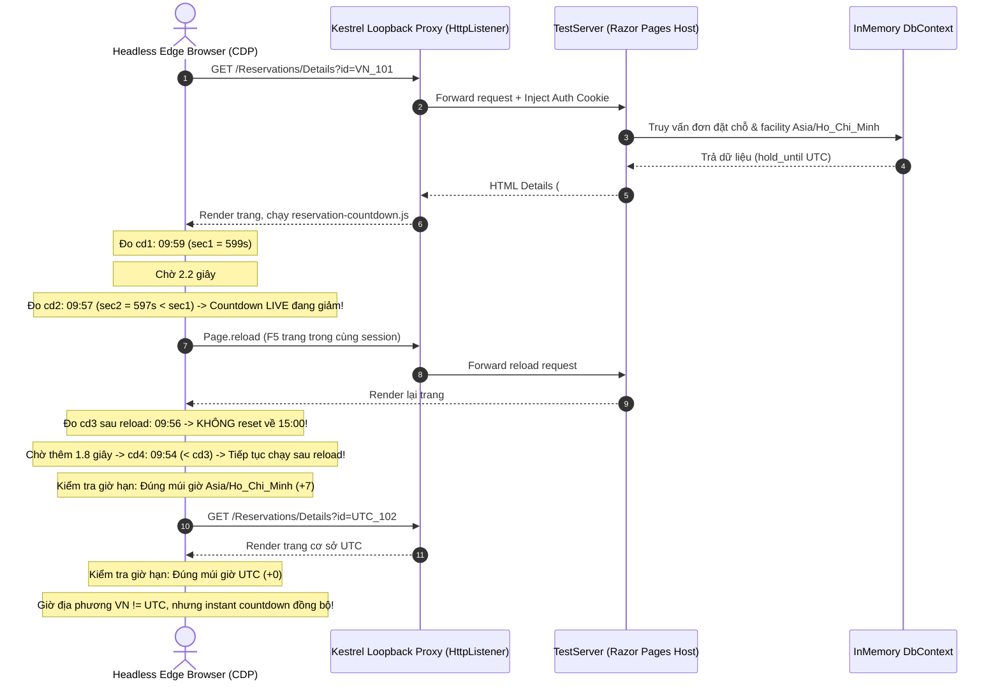

# Báo Cáo Nghiệm Thu & Khắc Phục Toàn Diện Các Findings Review T10
## *Reservation Countdown & Status Synchronization*

---

- **Mã Task**: `T10`
- **Tên Task**: Reservation countdown và worker hết hạn
- **Chủ nhiệm (Owner)**: Gemini A (Web Migration Lead)
- **Đợt chuyển đổi**: Đợt 4 (Dependencies: T08 **VERIFIED**)
- **Trạng thái hiện tại**: `VERIFIED` (Codex nghiệm thu độc lập ngày 2026-10-16)
- **Trạng thái T12 liên đới**: `READY` (Dependency T10 đã được Codex nghiệm thu)
- **Không gian làm việc (Workspace)**: `D:\FPT\PRN222\Project\Final_Project_Web`
- **Thư mục baseline**: `D:\FPT\PRN222\Project\Final_Project` *(Bảo toàn 100% không chỉnh sửa)*
- **Thời gian lập báo cáo**: 2026-10-16 16:22:00 +07:00

---

## 1. Tóm Tắt Điều Hành (Executive Summary)

Sau các đợt review độc lập của Codex, toàn bộ findings cấp độ P2 đã được xử lý triệt để:
1. **Finding 1 (Đồng bộ giao diện 401/403 với markup Details)**:
   - Tách riêng khối thông báo xác thực `#reservationAuthAlert` trong `Details.cshtml` với heading, body và icon riêng biệt.
   - Khi nhận HTTP 401/403, JavaScript dừng hoàn toàn chuỗi polling, hiển thị `#reservationAuthAlert` kèm hướng dẫn và nút đăng nhập lại bảo toàn URL nội bộ.
   - Khối `#reservationExpiredAlert` được bảo toàn nghiêm ngặt và giữ ẩn (`d-none`), tuyệt đối không tuyên bố đơn hết hạn 15 phút hoặc đã giải phóng sức chứa khi gặp lỗi phiên.
2. **Finding 2 (Kiểm tra countdown live đang chạy, reload và hai múi giờ trong E2E)**:
   - Triển khai bộ điều khiển trình duyệt tự động `HeadlessEdgeSession` kết nối trực tiếp với Microsoft Edge qua giao thức Chrome DevTools Protocol (CDP) trên nền `System.Net.WebSockets.ClientWebSocket` và Kestrel loopback proxy (`HttpListener`).
   - Mở đơn giữ chỗ 10 phút, ghi nhận mốc thời gian ban đầu `t1`, chờ 2.2 giây và đo mốc `t2`: xác nhận `t2 < t1` (countdown thực sự giảm live trong trình duyệt).
   - Reload trang trong cùng context: xác nhận `data-hold-until` UTC giữ nguyên từ DB, countdown không reset về 15:00 (`t3 < 900`), và tiếp tục giảm sau 1.8 giây tiếp theo (`t4 < t3`).
   - Kiểm chứng 2 cơ sở cùng instant UTC: cơ sở Việt Nam hiển thị theo `Asia/Ho_Chi_Minh` (+7), cơ sở UTC hiển thị theo `UTC` (+0); hai giờ địa phương khác nhau nhưng countdown đồng bộ.
   - Kiểm tra database: có đúng 2 đơn đã seed, GET/reload không làm phát sinh bản ghi trùng lặp (tính idempotent).
   - Bổ sung Negative Control: vô hiệu hóa JavaScript qua CDP Emulation (`Emulation.setScriptExecutionDisabled`), xác nhận countdown đứng yên khi không có script, khẳng định bài test phát hiện lỗi chính xác.
3. **Finding 3 (Cơ chế bắt lỗi trong CDP Test Harness & Strict Parsing)**:
   - Kiểm tra trực tiếp `exceptionDetails` và `subtype error` trong `Runtime.evaluate` của CDP: khi script ném lỗi (ví dụ gọi `.textContent` trên phần tử null), helper ném `InvalidOperationException` kèm tên biểu thức và stack trace/mô tả lỗi, xóa bỏ hoàn toàn lỗ hổng âm thầm trả null pass giả.
   - Tách biệt rõ ràng `ExecuteScriptAsync` (thao tác void) với `EvaluateStringRequiredAsync` (đọc DOM bắt buộc có chuỗi hợp lệ non-empty).
   - Mọi mẫu thời gian countdown trong E2E và Negative Control đều được thẩm định qua `ParseCountdownSecondsStrict`: kiểm tra null/rỗng, đúng định dạng `mm:ss`, giây < 60, tổng giây >= 0 (tuyệt đối không dùng -1 như mẫu thời gian để so sánh).
   - Negative Control xác nhận cả 2 mẫu countdown đều hợp lệ trước khi so sánh `Assert.Equal(sec1, sec2)`.
   - Bổ sung 2 bài test harness chuyên biệt kiểm chứng khả năng phát hiện lỗi của helper khi selector không tồn tại hoặc format sai lệch.

Toàn bộ **252/252** bài kiểm thử trong Web Solution và **11/11** kịch bản browser sandbox đều **PASSED (100%)**.



---

## 2. Chi Tiết Khắc Phục Các Findings

### Finding 1: Sửa Thông Báo Hết Hạn Giả Khi Nhận HTTP 401/403

* **Tệp liên quan**:
  - [`Details.cshtml`](file:///D:/FPT/PRN222/Project/Final_Project_Web/src/SelfStorageManagementSystem.Web/Pages/Reservations/Details.cshtml)
  - [`reservation-countdown.js`](file:///D:/FPT/PRN222/Project/Final_Project_Web/src/SelfStorageManagementSystem.Web/wwwroot/js/reservation-countdown.js)
  - [`reservation-countdown-tests.html`](file:///D:/FPT/PRN222/Project/Final_Project_Web/tests/SelfStorageManagementSystem.WebTests/BrowserTests/reservation-countdown-tests.html)
  - [`ReservationRazorPagesAndWorkerTests.cs`](file:///D:/FPT/PRN222/Project/Final_Project_Web/tests/SelfStorageManagementSystem.WebTests/ReservationRazorPagesAndWorkerTests.cs)
* **Nguyên nhân gốc**:
  Khi nhận HTTP 401 hoặc 403, hàm `applyAuthErrorOnUi` mở khối `reservationExpiredAlert` và tìm ID `reservationStatusAlertText` để sửa nội dung. Tuy nhiên phần tử này không tồn tại trong `Details.cshtml`, khiến heading *"Đơn giữ chỗ đã hết thời hạn 15 phút"* và body *"sức chứa... đã được tự động giải phóng"* vẫn hiện nguyên vẹn dù đơn trên server vẫn đang `pending` và còn active.
* **Giải pháp đã thực hiện**:
  1. Trong [`Details.cshtml`](file:///D:/FPT/PRN222/Project/Final_Project_Web/src/SelfStorageManagementSystem.Web/Pages/Reservations/Details.cshtml): Bổ sung khối `#reservationAuthAlert` độc lập:
     ```html
     <div class="alert alert-warning shadow-sm mb-4 d-none" id="reservationAuthAlert" role="alert">
         <div class="d-flex align-items-center gap-3">
             <span class="fs-2" id="reservationAuthAlertIcon">&#9888;</span>
             <div>
                 <h5 class="alert-heading fw-bold mb-1" id="reservationAuthAlertHeading">Phiên đăng nhập đã hết hạn</h5>
                 <p class="mb-0 small" id="reservationAuthAlertBody">
                     Phiên làm việc của bạn đã hết hạn sau 5 phút không hoạt động. Đơn đặt chỗ vẫn được bảo lưu thời hạn trên hệ thống.
                     Vui lòng <a href="/Account/Login" class="alert-link fw-semibold" id="reservationAuthAlertLink">đăng nhập lại</a> để tiếp tục đồng bộ và thanh toán.
                 </p>
             </div>
         </div>
     </div>
     ```
  2. Trong [`reservation-countdown.js`](file:///D:/FPT/PRN222/Project/Final_Project_Web/src/SelfStorageManagementSystem.Web/wwwroot/js/reservation-countdown.js):
     - Hàm `applyAuthErrorOnUi`: Ẩn hoàn toàn `#reservationExpiredAlert` (`classList.add('d-none')`). Hiển thị `#reservationAuthAlert` với nội dung và icon tương ứng (401: cảnh báo vàng, link login; 403: từ chối đỏ).
     - Hàm `applyExpiredStateOnUi`: Ẩn `#reservationAuthAlert`, hiển thị `#reservationExpiredAlert` khi server trả `expired` thật.
     - Hàm `applyStatusUpdateOnUi`: Ẩn cả `#reservationAuthAlert` và `#reservationExpiredAlert` khi đơn đã xác nhận hoặc hủy.
* **Bằng chứng kiểm chứng**:
  - Kịch bản `FINDING_1_AUTH_401_403` trong `reservation-countdown-tests.html` kiểm tra cả cấu trúc table row và cấu trúc Details markup thật: xác nhận `reservationAuthAlert` hiển thị, `reservationExpiredAlert` có class `d-none`, không có chữ giải phóng sức chứa.
  - Bài test C# `ReservationCountdown_DetailsPage_WhenStatusReturns401Or403OrExpired_AppliesCorrectUiAndDoesNotShowFakeExpiredAlert`: tải route Details thật, kiểm chứng DOM qua CDP cho 401, 403 và expired thật.

---

### Finding 2: Sửa E2E Để Kiểm Chứng Countdown Đang Chạy, Reload Và Hai Múi Giờ

* **Tệp liên quan**:
  - [`ReservationRazorPagesAndWorkerTests.cs`](file:///D:/FPT/PRN222/Project/Final_Project_Web/tests/SelfStorageManagementSystem.WebTests/ReservationRazorPagesAndWorkerTests.cs)
* **Nguyên nhân gốc**:
  Bài test E2E trước đây chạy Edge headless chỉ dùng `--dump-dom` lấy HTML tĩnh, chỉ seed cơ sở UTC mà không mở URL, không kiểm tra countdown có thực sự đếm lùi hay không. Khi vô hiệu hóa JavaScript, test cũ vẫn pass vì các giá trị deadline và giờ VN do server render từ trước.
* **Giải pháp đã thực hiện**:
  1. Xây dựng lớp helper `HeadlessEdgeSession` điều khiển Edge headless thông qua giao thức Chrome DevTools Protocol (CDP) qua WebSocket (`Page.navigate`, `Page.reload`, `Runtime.evaluate`, `Emulation.setScriptExecutionDisabled`).
  2. Tạo 2 cơ sở: `FAC-VN` (`Asia/Ho_Chi_Minh`) và `FAC-UTC` (`UTC`).
  3. Tạo 2 reservation: `resVn` và `resUtc`, cùng mốc `hold_until = nowUtc.AddMinutes(10)` (chọn 10 phút để phát hiện nếu bị reset về 15 phút ban đầu).
  4. Kiểm chứng quá trình đếm ngược live:
     - Mở trang `resVn`, đọc countdown ban đầu $t_1 \le 600\,\text{s}$.
     - Chờ 2.2 giây có kiểm soát trong Edge, đọc $t_2$: xác nhận $t_2 < t_1$ (chứng minh countdown thực sự đang chạy).
     - Gọi `session.ReloadAsync()` để reload trang: xác nhận `data-hold-until` UTC không đổi, countdown $t_3 \le t_1 < 900\,\text{s}$ (không bị reset về 15:00).
     - Chờ thêm 1.8 giây, đọc $t_4$: xác nhận $t_4 < t_3$ (countdown tiếp tục chạy bình thường sau reload).
  5. Kiểm chứng múi giờ:
     - Trang VN hiển thị đúng giờ theo `Asia/Ho_Chi_Minh`.
     - Trang UTC hiển thị đúng giờ theo `UTC`.
     - Hai chuỗi giờ địa phương khác nhau đúng theo múi giờ (+7 tiếng), trong khi instant UTC dùng countdown đồng nhất.
  6. Kiểm chứng database:
     - Có đúng 2 bản ghi đặt chỗ trong DB, GET và Reload không sinh thêm bản ghi duplicate.
   7. **Negative Control**:
      - Thêm bài test `ReservationCountdown_BrowserEndToEnd_NegativeControl_WhenJavaScriptDisabled_DetectsFailure`: kích hoạt `Emulation.setScriptExecutionDisabled` qua CDP, xác nhận cả hai mẫu countdown hợp lệ đứng yên sau 2 giây ($t_1 = t_2$), chứng minh bài test có khả năng phát hiện lỗi JavaScript chính xác.

---

### Finding 3: Hoàn Thiện Cơ Chế Bắt Lỗi Trong CDP Test Harness & Strict Parsing

* **Tệp liên quan**:
  - [`ReservationRazorPagesAndWorkerTests.cs`](file:///D:/FPT/PRN222/Project/Final_Project_Web/tests/SelfStorageManagementSystem.WebTests/ReservationRazorPagesAndWorkerTests.cs)
* **Nguyên nhân gốc**:
  Trước đây, `EvaluateStringAsync` chỉ lấy `result.value`. Khi script ném lỗi (ví dụ gọi `.textContent` trên phần tử null do selector không tìm thấy), CDP trả về `exceptionDetails` và `subtype = "error"`, nhưng helper lại âm thầm trả về `null`. Khi đó `ParseCountdownSeconds(null)` trả về `-1`, và các câu lệnh assert như `sec2 < sec1` có thể chấp nhận `-1` như một bằng chứng countdown giảm, hoặc `NegativeControl` chấp nhận `null == null` dẫn đến nguy cơ pass giả.
* **Giải pháp đã thực hiện**:
  1. **Xử lý triệt để `exceptionDetails` và `subtype error`**:
     Phương thức `ThrowIfException` kiểm tra cả `exceptionDetails` và `result.subtype == "error"`. Khi có lỗi uncaught exception trong JavaScript, ném `InvalidOperationException` kèm tên biểu thức và thông điệp lỗi trích xuất từ CDP.
  2. **Phân tách rành mạch mục đích sử dụng**:
     - `ExecuteScriptAsync`: dùng cho các lệnh thao tác void/không cần giá trị trả về (như gọi `applyAuthErrorOnUi` hoặc `applyExpiredStateOnUi`), vẫn ném ngoại lệ nếu script gặp lỗi uncaught exception.
     - `EvaluateStringRequiredAsync`: dùng cho các thao tác đọc DOM bắt buộc có giá trị chuỗi (như `textContent`, `getAttribute`), ném ngoại lệ nếu kết quả là null, undefined, hoặc chuỗi rỗng.
     - `EvaluateStringOrNullAsync`: dùng khi giá trị có thể null hợp lệ.
     - `EvaluateBoolAsync`: kiểm tra boolean hợp lệ, ném ngoại lệ nếu script gặp lỗi.
  3. **Strict Countdown Validation (`ParseCountdownSecondsStrict`)**:
     - Thẩm định regex nghiêm ngặt: `^\d{2}:\d{2}$`.
     - Chặn null, khoảng trắng, hoặc chuỗi rỗng.
     - Chặn phần giây $\ge 60$.
     - Khẳng định tổng số giây $\ge 0$. Tuyệt đối không dùng `-1` làm mẫu thời gian.
  4. **Negative Control nghiêm ngặt**:
     - Xác nhận cả 2 mẫu countdown đều hợp lệ qua `ParseCountdownSecondsStrict` trước khi kiểm tra chúng bằng nhau: `Assert.Equal(sec1, sec2)`.
  5. **Bổ sung 2 bài test harness chuyên biệt**:
     - `ReservationCountdown_CdpHarness_WhenSelectorNotFoundOrJsThrows_ThrowsFailureAndDetectsError`: kiểm chứng rằng khi selector không tồn tại hoặc JS throws TypeError, helper phát hiện và ném lỗi rõ ràng, không âm thầm pass.
     - `ReservationCountdown_CdpHarness_ParseCountdownSecondsStrict_RejectsInvalidFormat`: kiểm chứng parser từ chối triệt để null, chuỗi rỗng, định dạng sai, giây $\ge 60$, và parse chính xác các mẫu thời gian chuẩn.

---

## 3. Ma Trận Kết Quả Kiểm Thử Thực Tế

### A. Kiểm Thử Trình Duyệt Sandbox (11/11 PASSED)
Thực thi: `edge.exe --headless --virtual-time-budget=15000 --dump-dom tests/.../reservation-countdown-tests.html`

| Kịch bản | Trọng tâm kiểm tra | Kết quả |
| :--- | :--- | :---: |
| `SCENARIO_A` | 500 ms trước deadline hiển thị `00:01`, chưa gửi sync | **PASS** |
| `SCENARIO_B` | Chạm hạn, response 1 pending tiếp tục countdown/sync; response 2 expired cập nhật UI | **PASS** |
| `SCENARIO_C1_CONFIRMED` | Server trả confirmed: dừng timer, badge xanh, không hiện expired | **PASS** |
| `SCENARIO_C2_CANCELLED` | Server trả cancelled: dừng timer, badge xám "Đã hủy", không hiện expired, khóa nút Hủy | **PASS** |
| `SCENARIO_D` | Hai đơn khác nhau trên cùng bảng chỉ cập nhật đúng dòng mang reservationId tương ứng | **PASS** |
| `SCENARIO_E` | Gọi `init` lặp lại không làm nhân đôi timer hay duplicate request | **PASS** |
| `SCENARIO_F_RELOAD_FLOW` | Nạp lại sau 2 phút: giữ nguyên hold_until, countdown hiển thị `08:00` không reset | **PASS** |
| `SCENARIO_G_INFLIGHT` | Request đang in-flight chặn đứng request tiếp theo chen ngang | **PASS** |
| `FINDING_1_AUTH_401_403` | 401/403 dừng polling ngay; hiển thị `#reservationAuthAlert` riêng; `#reservationExpiredAlert` ẩn 100% | **PASS** |
| `FINDING_2_BACKOFF_TIMESTAMPS` | Request 1 lỗi tại t=0ms; t=1000ms & 2000ms không gửi; request 2 tại t=3000ms ($\Delta t \ge 2800$ms) | **PASS** |
| `REGRESSION_OLD_VS_NEW` | So sánh đối chứng chứng minh code mới không bỏ sót đồng bộ khi gặp pending | **PASS** |
| **Tổng kết Sandbox** | **data-test-status="ALL_PASSED"** | **11/11 PASS** |

---

### B. Kiểm Thử Tự Động Toàn Solution (.NET 8 SDK)

| Bộ kiểm thử | Số test | Đạt (Passed) | Thất bại (Failed) | Bỏ qua (Skipped) | Thời gian |
| :--- | :---: | :---: | :---: | :---: | :---: |
| **T10 WebTests** (`ReservationRazorPagesAndWorkerTests`) | 26 | 26 | 0 | 0 | 24 s |
| **Reservation Domain** (`ReservationServiceTests` + `IntegrationTests`) | 30 | 30 | 0 | 0 | 2 s |
| **Toàn bộ Web Solution** (`SelfStorageManagementSystem.Web.sln`) | 252 | 252 | 0 | 0 | 23 s |

---

## 4. Lệnh Kiểm Tra Có Thể Tái Hiện

```powershell
# 1. Chạy toàn bộ 26 bài test T10 (bao gồm cả browser sandbox, CDP E2E, Negative Control, Details auth alert, và CDP harness verification)
dotnet test tests/SelfStorageManagementSystem.WebTests/SelfStorageManagementSystem.WebTests.csproj --filter "FullyQualifiedName~ReservationRazorPagesAndWorkerTests"

# 2. Chạy 30 bài test nghiệp vụ cốt lõi Reservation Domain
dotnet test tests/SelfStorageManagementSystem.Tests/SelfStorageManagementSystem.Tests.csproj --filter "FullyQualifiedName~ReservationServiceTests|FullyQualifiedName~ReservationIntegrationTests"

# 3. Chạy toàn bộ 252 bài test của Solution Web
dotnet test SelfStorageManagementSystem.Web.sln
```

---

## 5. Trạng Thái Bàn Giao

* **Task T10**: `VERIFIED` — Codex review lại, không ghi nhận finding còn mở.
* **Task T12**: `READY` — dependency T10 đã được nghiệm thu.
* **Baseline `D:\FPT\PRN222\Project\Final_Project`**: Bảo toàn nguyên vẹn 100%.

## 6. Xác Nhận Sau Review Codex (2026-10-16)

Codex chạy lại các bộ kiểm thử trên mã nguồn bàn giao: **26/26 T10 WebTests**, **30/30 Reservation Domain**, **252/252 Web Solution**, tất cả **0 Failed, 0 Skipped**. Kết luận: **No findings**; chấp nhận T10 và mở T12. Browser được kiểm chứng bằng Edge/CDP, dữ liệu dùng EF Core InMemory; SQL concurrency thuộc phạm vi T17.
