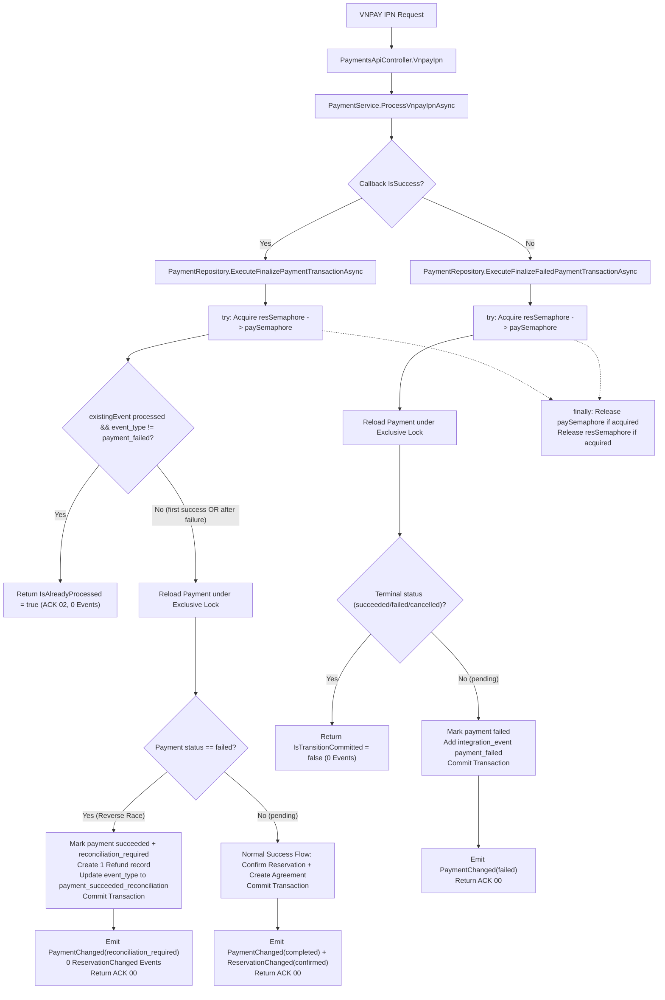

# Báo Cáo Sửa Finding Vòng R5 — Task T15 (Realtime Web Integration)

- **Ngày thực hiện**: 2026-10-18
- **Tác giả**: Gemini A (Foundation & Integration Lead)
- **Không gian làm việc chính**: `D:\FPT\PRN222\Project\Final_Project_Web`
- **Không gian làm việc đồng bộ**: `D:\FPT\PRN222\Project\Final_Project`
- **Trạng thái task T15**: **T15 IMPLEMENTED — chờ Codex review**
- **Trạng thái kế thừa T12 / T13 / T14**: **VERIFIED** (bảo toàn 100% route `/storageUnitHub`, 3 Hub methods `HubCreate_StorageUnit`, `HubUpdate_StorageUnit`, `HubDelete_StorageUnit` và 3 Receiver CRUD events)
- **Trạng thái T16–T18**: **WAITING** (không tự ý khởi động)

---

## 1. Mục Tiêu và Phạm Vi Vòng R5

Vòng R5 tập trung giải quyết triệt để hai finding P1 & P2 từ kết quả review độc lập của Codex đối với báo cáo R4 (`WebMigration_T15_R4_FindingFixes.md`):

1. **R4-F01 [P1] — Không bỏ qua success sau decline khi cùng transaction ID**:
   - Vị trí: `src/SelfStorageManagementSystem.DataAccess/Repositories/Implementations/PaymentRepository.cs:815–839` và `:903–905`.
   - Vấn đề: Callback decline trước đó ghi `integration_event` với trạng thái `processed` và `event_type = "payment_failed"`. Khi callback success đến sau với cùng `vnp_TxnRef = X` và `vnp_TransactionNo = Y` (cùng external ID `VNPAY-X-Y`), nhánh kiểm tra idempotency thấy event đã tồn tại với `status == "processed"`, lập tức trả về `IsAlreadyProcessed = true` trước khi kiểm tra trạng thái thực của payment trong database. Kết quả: Nhánh reverse race (`PAYMENT_ALREADY_FAILED`) không được kích hoạt, tiền đã thanh toán qua ngân hàng không được ghi nhận, không tạo bản ghi `refund` đối soát, service trả ACK `02` và phát 0 sự kiện realtime.
2. **R4-F02 [P2] — Giải phóng reservation semaphore nếu việc chờ khóa payment bị hủy**:
   - Vị trí: `src/SelfStorageManagementSystem.DataAccess/Repositories/Implementations/PaymentRepository.cs:753–759`, `:1324–1330`, `:234–250`.
   - Vấn đề: Cơ chế khóa In-Memory dùng thứ tự `reservationSemaphore` rồi mới đến `paymentSemaphore`. Khi Request B đã acquire thành công `reservationSemaphore` và đang ở trạng thái `await paymentSemaphore.WaitAsync(..., cancellationToken)`, nếu `cancellationToken` bị kích hoạt (cancellation hoặc timeout), `OperationCanceledException` phát sinh nằm ngoài khối `try/finally` bảo vệ, khiến `reservationSemaphore` bị rò rỉ vĩnh viễn (không bao giờ được release). Request tiếp theo (Request C) cùng reservation sẽ bị nghẽn (hang hoặc timeout) vô thời hạn.

---

## 2. Nguyên Nhân Gốc Rễ và Thiết Kế Khắc Phục

### 2.1. Khắc phục Finding R4-F01 [P1] (Idempotency Event Type Filtering)

- **Nguyên nhân**: Idempotency key `VNPAY-{paymentId}-{transactionNo}` được dùng chung cho cả callback thành công và thất bại. Một callback thất bại trước đó đã đánh dấu `status = "processed"` cho key này. Khi success callback hợp lệ cùng số giao dịch đến sau, điều kiện `existingEvent != null && existingEvent.status == "processed"` ngộ nhận rằng giao dịch thành công đã được xử lý xong.
- **Giải pháp**:
  - Tại `PaymentRepository.ExecuteFinalizePaymentTransactionAsync`:
    Cập nhật điều kiện lọc:
    ```csharp
    var existingEvent = await _context.integration_events
        .FirstOrDefaultAsync(e => e.source == parameters.Provider &&
                                  e.external_event_id == parameters.ExternalEventId,
                                  cancellationToken);

    if (existingEvent != null &&
        existingEvent.status == "processed" &&
        existingEvent.event_type != "payment_failed")
    {
        // Nhánh xử lý callback success trùng lặp (idempotent duplicate)
        ...
    }
    ```
  - Khi `existingEvent` mang `event_type == "payment_failed"`, luồng không dừng ở nhánh idempotency mà tiếp tục nạp trạng thái thanh toán mới nhất dưới khóa độc quyền.
  - Tại đây, hệ thống phát hiện `payment.status == "failed"`, kích hoạt nhánh reverse race:
    - Cập nhật trạng thái payment thành `succeeded`, lưu `failure_reason = "PAYMENT_ALREADY_FAILED"`.
    - Gắn cờ metadata `{"reconciliation_required": true}`.
    - Tạo đúng 1 bản ghi `refund` với lý do `"PAYMENT_ALREADY_FAILED - Success callback received after payment was marked failed"`.
    - Tái sử dụng bản ghi `integration_event` hiện có: cập nhật `existingEvent.event_type = "payment_succeeded_reconciliation"` và `existingEvent.payload = parameters.RawPayloadJson`.
    - Tuyệt đối **không** tạo hợp đồng thuê (`rental_agreement`) và **không** xác nhận giữ chỗ (`reservation`).
    - `PaymentService` nhận diện `reconciliation_required`, trả mã ACK VNPAY `00`, phát sự kiện `PaymentChanged(reconciliation_required)`, và phát 0 sự kiện `ReservationChanged`.
  - Nếu callback success cùng ID tiếp tục được gửi lại (retry lần 2): Vì `event_type` giờ đây đã là `"payment_succeeded_reconciliation"` (khác `"payment_failed"`), nhánh idempotency sẽ kích hoạt, trả ACK `02`, phát 0 sự kiện mới và không tạo bản ghi refund trùng lặp.

### 2.2. Khắc phục Finding R4-F02 [P2] (Atomic Semaphore Acquisition & Try/Finally)

- **Nguyên nhân**: Việc acquire semaphore diễn ra trước hoặc ngoài khối `try/finally` an toàn. Khi nhiều semaphore cần acquire tuần tự theo phân cấp, nếu semaphore thứ hai ném exception do `CancellationToken`, semaphore thứ nhất không được dọn dẹp.
- **Giải pháp**:
  - Đưa toàn bộ việc acquire semaphore vào bên trong khối `try`.
  - Khai báo các cờ boolean theo dõi trạng thái khóa: `bool resSemaphoreAcquired = false;` và `bool paySemaphoreAcquired = false;` (cùng `promoSemaphoreAcquired` trong checkout hold).
  - Khối `finally` bảo đảm dọn dẹp chính xác:
    ```csharp
    finally
    {
        if (transaction != null) await transaction.DisposeAsync();
        if (paySemaphoreAcquired) inMemoryPaySemaphore?.Release();
        if (resSemaphoreAcquired) inMemoryResSemaphore?.Release();
    }
    ```
  - Áp dụng đồng bộ cấu trúc này trên cả 3 giao dịch tài chính cốt lõi trong `PaymentRepository`:
    1. `CreatePaymentHoldTransactionAsync` (giữ khóa reservation và promotion).
    2. `ExecuteFinalizePaymentTransactionAsync` (giữ khóa reservation và payment).
    3. `ExecuteFinalizeFailedPaymentTransactionAsync` (giữ khóa reservation và payment).
  - Xuất bảng semaphore `InMemorySemaphores` ở phạm vi `internal static` và cấu hình `InternalsVisibleTo` trong `SelfStorageManagementSystem.DataAccess.csproj` cho `SelfStorageManagementSystem.Tests` và `SelfStorageManagementSystem.WebTests` để phục vụ kiểm thử định hướng race condition và cancellation.

---

## 3. Đường Đi Lệnh (Call Paths) Sau Khi Tối Ưu



---

## 4. Kết Quả Kiểm Thử và Nghiệm Thu Thực Tế

### 4.1. Bộ Kiểm Thử Concurrency Định Hướng (6/6 PASS)

Lệnh thực thi:
```powershell
dotnet test tests/SelfStorageManagementSystem.WebTests/SelfStorageManagementSystem.WebTests.csproj --filter "FullyQualifiedName~R4_Concurrency|FullyQualifiedName~R5_Concurrency"
```

Kết quả: **Passed: 6, Failed: 0, Skipped: 0 (Duration: 27 s)**.

1. `R4_Concurrency_TwoDeclineCallbacks_SamePayment_OnlyOneTransitionCommitted_OnlyOneRealtimeFailedEmitted`: Hai callback decline đồng thời cùng payment qua 2 DbContext riêng biệt, chỉ duy nhất 1 callback commit thành công và phát đúng 1 sự kiện `PaymentChanged(failed)`.
2. `R4_Concurrency_DeclineVersusSuccess_SuccessWins_DeclineDoesNotOverwrite`: Success commit trước, decline đến sau nhận diện terminal status `succeeded`, không ghi đè, phát 0 sự kiện failed.
3. `R4_Concurrency_DeclineVersusSuccess_DeclineWins_SuccessDoesNotOverwrite`: Decline commit trước, success đến sau kích hoạt reverse race, chuyển `reconciliation_required`, không xác nhận reservation.
4. `R4_Concurrency_ReverseRace_SuccessAfterDeclineCommitted_RequiresReconciliation_NeverConfirmsReservation`: **(R4-F01)** Decline rồi Success với **cùng TxnRef và cùng TransactionNo (`14073849`)**:
   - Bước 1: Decline commit `failed`, phát 1 `PaymentChanged(failed)`.
   - Bước 2: Success cùng transactionNo được xử lý qua nhánh reconciliation, payment chuyển `succeeded` với `reconciliation_required = true`, tạo đúng 1 bản ghi `refund`, phát đúng 1 `PaymentChanged(reconciliation_required)`, phát 0 sự kiện `ReservationChanged`.
   - Bước 3: Retry success lần 2 với cùng transactionNo kích hoạt idempotency, trả ACK `02`, phát 0 sự kiện mới, không tạo refund trùng lặp (tổng refund vẫn là 1).
5. `R5_Concurrency_SuccessThenDecline_SameTransactionNo_DeclineDoesNotOverwrite`: Success commit `succeeded`, sau đó decline cùng transactionNo đến sau không ghi đè trạng thái `succeeded`, trả ACK `02`, phát 0 sự kiện mới.
6. `R5_Concurrency_CancelledWaitingPaymentLock_ReleasesReservationSemaphore_AndSubsequentRequestSucceeds`: **(R4-F02)** Kiểm thử định hướng cancellation cho cả 2 nhánh finalize success và finalize decline:
   - Request A giữ `paymentSemaphore`.
   - Request B acquire thành công `reservationSemaphore` và đang chờ `paymentSemaphore`. `CancellationToken` của B được kích hoạt -> ném `OperationCanceledException`.
   - Kiểm tra `reservationSemaphore` đã được giải phóng an toàn ngay lập tức.
   - Request C cùng reservation và payment thực hiện ngay sau đó: thành công trọn vẹn, không timeout, không phát sinh `SemaphoreFullException`.

### 4.2. Kiểm Thử Kiến Trúc Clean Architecture (2/2 PASS)

Lệnh thực thi:
```powershell
dotnet test tests/SelfStorageManagementSystem.WebTests/SelfStorageManagementSystem.WebTests.csproj --filter "FullyQualifiedName~Architecture_MvcWebApp_DoesNotReferenceDataAccessOrApiOrWpf|FullyQualifiedName~MvcWebApp_DoesNotReferenceDataAccessOrApiOrWpf"
```
Kết quả: **Passed: 2, Failed: 0, Skipped: 0 (Duration: 1 s)**.
Web assembly (`Program.Assembly`) hoàn toàn không tham chiếu `SelfStorageManagementSystem.DataAccess`.

### 4.3. Toàn Bộ Test Suite WebTests (403/403 PASS)

Lệnh thực thi:
```powershell
dotnet test tests/SelfStorageManagementSystem.WebTests/SelfStorageManagementSystem.WebTests.csproj
```
Kết quả: **Passed: 403, Failed: 0, Skipped: 0 (Duration: 4 m 36 s)**.

### 4.4. Toàn Bộ Test Suite Hồi Quy BLL / DAL (225 PASS, 8 SKIP)

Lệnh thực thi:
```powershell
dotnet test tests/SelfStorageManagementSystem.Tests/SelfStorageManagementSystem.Tests.csproj
```
Kết quả: **Passed: 225, Failed: 0, Skipped: 8, Total: 233 (Duration: 2 s)**.

### 4.5. Kiểm Tra Cú Pháp JavaScript (10/10 PASS)

Lệnh thực thi:
```powershell
Get-ChildItem -Recurse -Filter *.js src/SelfStorageManagementSystem.Web/wwwroot/js | ForEach-Object { node --check $_.FullName }
```
Kết quả: **10/10 JavaScript files hợp lệ, không có lỗi cú pháp**.

### 4.6. Kiểm Tra Đồng Bộ Sang Workspace `Final_Project` (6/6 & 2/2 PASS)

Đã sao chép toàn bộ các tệp thay đổi sang `D:\FPT\PRN222\Project\Final_Project`.
Chạy kiểm thử tại `Final_Project`:
- Concurrency Tests: **Passed: 6, Failed: 0, Skipped: 0**.
- Architecture Tests: **Passed: 2, Failed: 0, Skipped: 0**.

---

## 5. Bảng Mã Băm SHA-256 Các Tệp Thay Đổi Trong Vòng R5

| Đường Dẫn Tệp | SHA-256 Checksum | Ghi Chú |
| :--- | :--- | :--- |
| `src/SelfStorageManagementSystem.DataAccess/SelfStorageManagementSystem.DataAccess.csproj` | `46A41F0BAB5F44D56248033F55A8D0A35634406CE4D54D8041BFE526265879A1` | Cấu hình `InternalsVisibleTo` cho WebTests & Tests |
| `src/SelfStorageManagementSystem.DataAccess/Repositories/Implementations/PaymentRepository.cs` | `A21995C426182E69CA0A6D24FD79BDA621AE3479E056EEB2D11383FD9824EBB9` | Idempotency filtering (`event_type != "payment_failed"`), try/finally atomic semaphore release |
| `tests/SelfStorageManagementSystem.WebTests/WebRealtimeIntegrationTests.cs` | `5BFD6250BB8B3CE5A49FFC6006A3836ECECEFF67039F66F78E9EE94172F490A7` | Cập nhật kịch bản reverse race cùng transactionNo và thêm 2 test R5 |

*(Ghi chú: Cả 3 tệp trên đều có mã băm SHA-256 đồng nhất 100% giữa `Final_Project_Web` và `Final_Project`)*.

---

## 6. Kết Luận Bàn Giao

1. Hai finding P1 & P2 (R4-F01 và R4-F02) đã được khắc phục triệt để với logic chặt chẽ, an toàn giao dịch và giải phóng tài nguyên tin cậy.
2. Không có bất kỳ hồi quy nào đối với các chức năng đã VERIFIED của T12, T13, T14 (đặc biệt `/storageUnitHub`, ba phương thức Hub và ba sự kiện Receiver CRUD).
3. Tuyệt đối không để lộ mã PIN, entity EF Core, hoặc thông tin thanh toán nhạy cảm ra ngoài SignalR hay logs.
4. Trạng thái task T15 được duy trì chính xác: **`T15 IMPLEMENTED — chờ Codex review`**. Không tự ý đánh dấu `VERIFIED` và không khởi động T16–T18.
